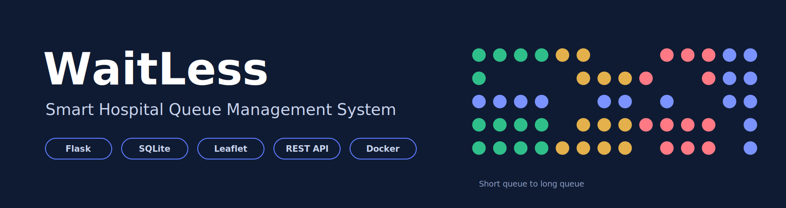
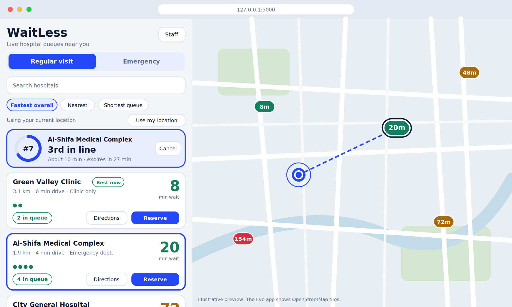
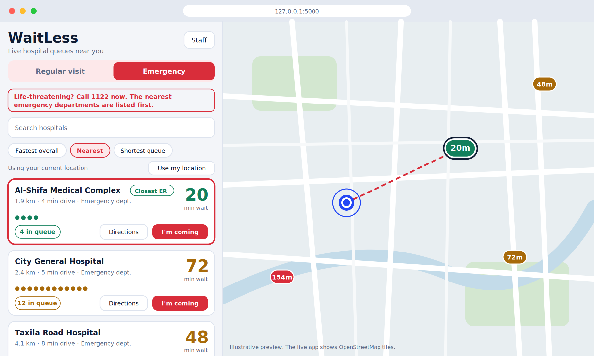
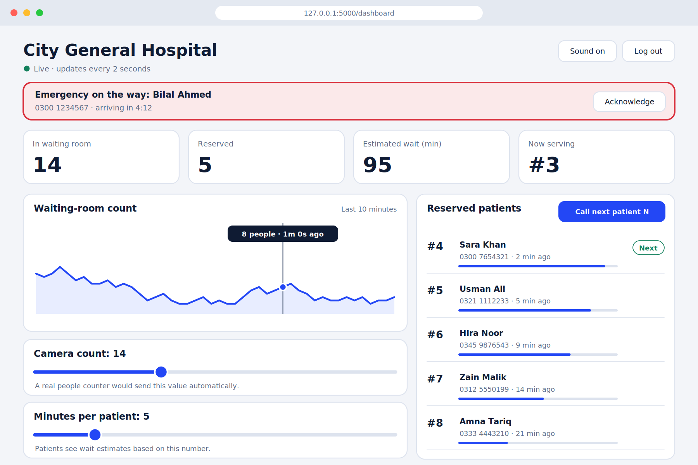
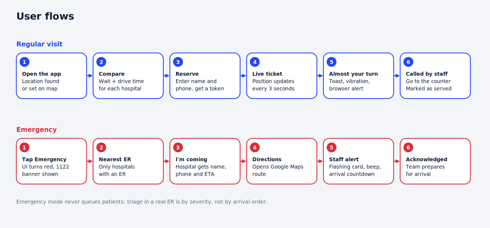
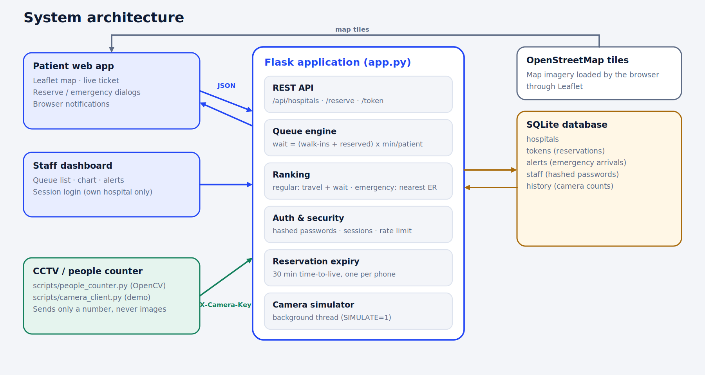
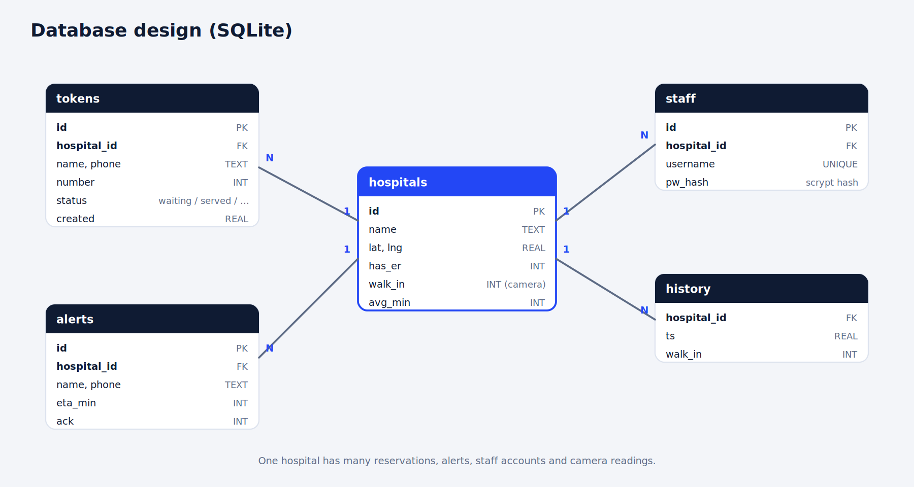

<p align="center"></p>

<p align="center">
  <a href="https://github.com/YOUR_USERNAME/waitless-hospital-queue/actions/workflows/ci.yml"></a>
  
  
  
</p>

# WaitLess: Smart Hospital Queue Management System

WaitLess helps people choose a hospital with a short wait and reserve their place in line from their phone, so they spend less time in crowded waiting rooms. Hospitals get a live dashboard with their queue, incoming reservations and emergency arrivals.

It was built as an App Development course project and is a complete, runnable full-stack system: a Flask REST API, a SQLite database, a responsive web app with a live map, a staff dashboard with login, automated tests, Docker support and CI.

## Table of contents
- [The problem](#the-problem) · [Features](#features) · [Screenshots](#screenshots) · [How it works](#how-it-works)
- [Architecture](#architecture) · [Tech stack](#tech-stack) · [Project structure](#project-structure)
- [Getting started](#getting-started) · [Demo walkthrough](#demo-walkthrough) · [Configuration](#configuration)
- [Connecting a real camera](#connecting-a-real-camera) · [API](#api) · [Testing](#testing-and-linting)
- [Security and privacy](#security-and-privacy) · [Limitations and roadmap](#limitations-and-roadmap) · [Contributing](#contributing) · [License](#license)

## The problem
Hospital waiting rooms are often overcrowded while a hospital a few kilometres away is nearly empty. Patients have no way to know, and in an emergency there is no time to phone around. WaitLess shows live queue information for nearby hospitals, estimates the total time (drive plus wait), and lets patients reserve a number or warn an emergency department that they are on the way.

## Features

**For patients**
- Live map with a colour-coded marker for every hospital showing its current wait in minutes (green = short, amber = medium, red = long)
- Hospitals ranked by total time (drive time + wait), nearest, or shortest queue, plus search
- Reserve a queue number in two taps and follow a live ticket with position, estimated wait and a progress ring
- Alert when your turn is near (on-screen message, vibration and browser notification)
- One-tap Google Maps directions; set your location by dragging the blue dot or tapping the map

**Emergency mode**
- The whole interface switches to red and shows an emergency-number banner (1122 in Pakistan; change it for your country)
- Lists only hospitals that have an emergency department, nearest first
- "I'm coming" sends the hospital your name, phone and arrival time instead of joining a queue (real emergency rooms triage by severity, not arrival order)

**For hospital staff**
- Secure login; each account can manage only its own hospital
- Live tiles: people in the waiting room, reserved patients, estimated wait, now serving
- Interactive chart of the waiting-room count over the last 10 minutes
- Reserved patient list with expiry bars and a "Call next patient" button (keyboard shortcut **N**)
- Flashing emergency alerts with an arrival countdown and sound
- Sliders for the camera count and the average minutes per patient

**Platform**
- Reservations expire after 30 minutes and each phone number may hold one active reservation (stops hoarding and no-shows)
- Camera endpoint protected by an API key; an optional OpenCV people-counting script is included
- 14 automated tests, linting, GitHub Actions CI, Dockerfile

## Screenshots
> These are UI previews drawn from the app's design. The live app uses real OpenStreetMap tiles on the map.

**Patient app: compare hospitals, reserve, follow your live ticket**


**Emergency mode: nearest emergency departments, one-tap alert**


**Staff dashboard: queue, chart, emergency alerts and controls**


## How it works

| Idea | Rule |
|---|---|
| Hospital load | `queue = people counted in the waiting room (camera) + reserved patients waiting` |
| Estimated wait | `wait = queue x average minutes per patient` (staff can change the average) |
| Drive time | straight-line distance (haversine) at an assumed 30 km/h |
| Regular ranking | lowest `drive time + wait` first |
| Emergency ranking | hospitals with an ER only, nearest first |
| Level colour | queue of 8 or fewer = green, 18 or fewer = amber, otherwise red |
| Reservation | gets the next number at that hospital; expires after 30 minutes if not used |



## Architecture


The browser apps poll the Flask JSON API every few seconds. A background thread simulates a CCTV people counter for demos; in a real deployment, a camera script posts the count to a protected endpoint instead (set `SIMULATE=0`). More detail is in [docs/ARCHITECTURE.md](docs/ARCHITECTURE.md).



## Tech stack
| Layer | Technology |
|---|---|
| Backend | Python 3, Flask, SQLite (standard library `sqlite3`) |
| Frontend | HTML, CSS and vanilla JavaScript, Leaflet and OpenStreetMap |
| Security | Werkzeug password hashing, cookie sessions, login rate limiting |
| Tooling | pytest, Ruff, GitHub Actions, Docker |
| Optional | OpenCV (HOG person detector) for people counting |

## Project structure
```
.
├── app.py                  Flask app: API, auth, queue logic, camera simulator
├── templates/              patient.html, dashboard.html, login.html
├── static/style.css        Shared styles (light and dark mode)
├── tests/test_api.py       14 pytest tests
├── scripts/
│   ├── camera_client.py    Send people counts to the server (demo camera)
│   └── people_counter.py   Experimental OpenCV people counter
├── docs/                   API.md, ARCHITECTURE.md, images/
├── .github/                CI workflow, issue and PR templates
├── Dockerfile · docker-compose.yml · .env.example
├── requirements*.txt · pyproject.toml
└── LICENSE · CHANGELOG.md · CONTRIBUTING.md · SECURITY.md
```

## Getting started

**Requirements:** Python 3.10 or newer. Internet access is needed for the map tiles.

```bash
git clone https://github.com/YOUR_USERNAME/waitless-hospital-queue.git
cd waitless-hospital-queue

python -m venv .venv
source .venv/bin/activate        # Windows: .venv\Scripts\activate
pip install -r requirements.txt

python app.py
```
Open **http://127.0.0.1:5000** for the patient app and **http://127.0.0.1:5000/login** for staff.

**Demo staff accounts:** `hospital1` to `hospital5`, password `demo123` (change these before any real use).

**Docker**
```bash
docker compose up --build
```
The app is then available at http://localhost:5000 and the database is kept in a Docker volume.

## Demo walkthrough
1. Open the patient app and the staff dashboard (log in as `hospital1`) in two browser windows.
2. Patient: pick a hospital and press **Reserve**. Watch your position and progress ring.
3. Staff: press **Call next patient** (or **N**). The patient's ticket updates.
4. Patient: switch to **Emergency** and press **I'm coming**. The staff dashboard shows a flashing alert with a countdown.
5. Staff: move the camera-count slider and watch the patient map markers change.
6. Try opening `/api/dashboard/2` while logged in as `hospital1`: access is refused.

The demo hospitals are placed around Haripur, Pakistan. Edit the `SEED` list in `app.py` to use your own city.

## Configuration
Settings come from environment variables (see `.env.example`).

| Variable | Default | Purpose |
|---|---|---|
| `SECRET_KEY` | `dev-only-change-me` | Signs login sessions. **Set a long random value outside demos.** |
| `CAMERA_KEY` | `camera-demo-key` | Key a camera script sends in the `X-Camera-Key` header |
| `HOST` / `PORT` | `127.0.0.1` / `5000` | Where the server listens |
| `DB_PATH` | `queue.db` | SQLite file location |
| `SIMULATE` | `1` | `1` = built-in fake camera, `0` = real camera sends the counts |

## Connecting a real camera
Cameras send only a **number**, never video or images.

```bash
SIMULATE=0 python app.py                                             # turn off the fake camera

python scripts/camera_client.py --hospital 1 --count 14              # send one count
python scripts/camera_client.py --hospital 1 --loop 3                # keep sending changing counts

pip install -r requirements-camera.txt                               # optional OpenCV counter
python scripts/people_counter.py --source 0 --hospital 1 --interval 5
```
`people_counter.py` uses OpenCV's built-in HOG person detector. It is experimental and was only smoke-tested on a blank image here. For real accuracy, swap in a modern detector such as YOLO.

## API
All endpoints return JSON. Summary:

| Method | Endpoint | Who | Purpose |
|---|---|---|---|
| GET | `/api/hospitals?lat&lng&mode` | public | Ranked hospitals with queue and wait |
| POST | `/api/reserve` | public | Reserve a queue number |
| GET | `/api/token/<id>` | public | Position, wait and status of a reservation |
| POST | `/api/token/<id>/cancel` | public | Cancel a reservation |
| POST | `/api/emergency` | public | Tell an ER you are on the way |
| POST | `/api/login` · `/api/logout` | staff | Start and end a staff session |
| GET | `/api/dashboard/<hospital_id>` | staff | Queue, alerts and settings for a hospital |
| POST | `/api/dashboard/<id>/next` · `/service-time` | staff | Call next patient, set minutes per patient |
| POST | `/api/dashboard/<id>/camera` | staff or camera key | Set the waiting-room count |

Full request and response examples: [docs/API.md](docs/API.md).

## Testing and linting
```bash
pip install -r requirements-dev.txt
pytest -q          # 14 tests
ruff check .
```
The tests cover ranking, reservations, expiry, login rate limiting, per-hospital access control, emergency alerts and the camera key.

## Security and privacy
- Staff passwords are stored as salted hashes; sessions use HTTP-only cookies; staff can only access their own hospital; failed logins are rate limited.
- Patient data is limited to a name and phone number used for the reservation. Camera scripts send counts only, and no images are stored.
- The demo passwords, `SECRET_KEY` and `CAMERA_KEY` are for demonstration. Change them and serve the app over HTTPS before real use. Report vulnerabilities as described in [SECURITY.md](SECURITY.md).

## Limitations and roadmap
- Demo hospitals and simulated camera counts; no real hospital integration yet
- Updates use polling every few seconds rather than WebSockets or server-sent events
- Drive time is estimated from straight-line distance, not real road routing
- Notifications are browser-based; SMS (for example Twilio) and mobile push are not included
- SQLite and an in-process login limiter suit a single server; use PostgreSQL and a shared store to scale out

Planned: real-time push updates, SMS alerts, road-routing ETA, multi-department queues, an admin panel for adding hospitals, and a YOLO-based people counter.

## Contributing
Contributions are welcome. See [CONTRIBUTING.md](CONTRIBUTING.md) for setup and guidelines.

## License
Released under the [MIT License](LICENSE).

## Acknowledgements
Map data © [OpenStreetMap](https://www.openstreetmap.org/copyright) contributors, rendered with [Leaflet](https://leafletjs.com/). Built with [Flask](https://flask.palletsprojects.com/).

## Author
Your Name · [GitHub](https://github.com/YOUR_USERNAME) · course: App Development
